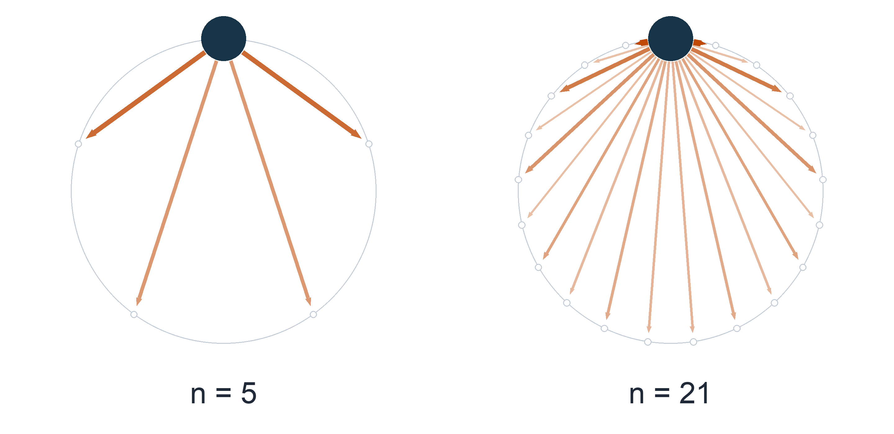
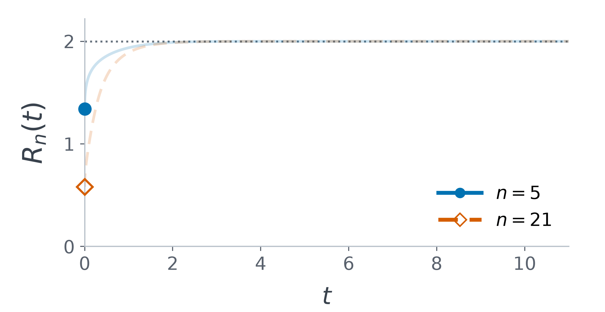

# Sharp log-Sobolev inequality on finite cyclic groups

This project uses [Lean](https://lean-lang.org/), a programming language in which a computer can verify mathematical proofs, to verify the sharp log-Sobolev inequality in Theorem 1 of:

> Xinyuan Xie and Haonan Zhang,
> *Sharp log-Sobolev inequalities and quartic stability on finite cyclic groups*,
> [arXiv:2606.02847](https://arxiv.org/abs/2606.02847).

<p align="center">
  <a href="assets/word-length-semigroup.png">
    
  </a>
</p>

*The hot spot at the origin spreads along the discrete cycle according to the long-range interaction rule specified by $`A_{\psi}`$ (defined below), until all nodes reach the same temperature.*

<p align="center">
  <a href="assets/entropy-energy-ratio.png">
    
  </a>
</p>

```math
R_n(t)=\frac{\mathrm{Ent}_{\pi}(\rho_t)}{\mathcal E_n(\sqrt{\rho_t})}.
```

Here $`\rho_t`$ is the heat density; $`\mathrm{Ent}_{\pi}(\rho_t)`$ and $`\mathcal E_n(\sqrt{\rho_t})`$ are the relative entropy and the Dirichlet energy. The plotted ratio approaches $`2`$ from below; the following theorem shows that it cannot exceed $`2`$.

## Mathematical statement

Let $`\mathbb{Z}_n=\mathbb{Z}/n\mathbb{Z}`$ be the cyclic group equipped with the uniform probability measure $`\pi`$, and denote by $`\pi(g)`$ the average $`\frac{1}{n}\sum_{x\in\mathbb{Z}_n}g(x)`$.

<a name="theorem-1"></a>

**Theorem 1.** For every $`n\geq 4`$ and every nonnegative $`f:\mathbb{Z}_n\to\mathbb{R}`$,

```math
\mathrm{Ent}_{\pi}(f^2)\leq 2\mathcal{E}_n(f). \qquad (1)
```

Here $`\mathrm{Ent}_{\pi}(g)=\pi(g\log g)-\pi(g)\log\pi(g)`$ for nonnegative $`g`$, with natural logarithms and $`0\log 0=0`$, and the Dirichlet form is

```math
\mathcal{E}_n(f)=\sum_{k=0}^{n-1}\min(k,n-k)\,|\widehat f(k)|^2,
```

where

```math
\widehat f(k)=\frac{1}{n}\sum_{x=0}^{n-1}f(x)e^{-2\pi i kx/n}.
```

The Laplacian in the animation is

```math
A_{\psi}f(x)=\sum_{k=0}^{n-1}\min(k,n-k)\,\widehat f(k)e^{2\pi i kx/n},
```

with $`\partial_t\rho_t=-A_{\psi}\rho_t`$ and $`\rho_0=n\mathbf{1}_{\{0\}}`$.

The constant $`2`$ is sharp by the standard perturbation argument recalled in [Section 5 of the paper](https://arxiv.org/html/2606.02847#S5), and the formalization here concerns only the inequality part.

## Verification
<!--
The verification is done by [`lake comparator`](https://lean-lang.org/doc/reference/latest/Build-Tools-and-Distribution/Lake/#comparator), a command in the Lean toolchain that compiles [Challenge.lean](Challenge.lean) and [Solution.lean](Solution.lean) independently and checks whether the proof in the latter proves the theorem stated in the former using the axioms allowed in [`comparator.json`](comparator.json).
-->
To verify the correctness of the inequality in Lean, one only needs to check that the statement and definitions in [Challenge.lean](Challenge.lean) match the [Theorem 1](#theorem-1) stated above, <!--review the configuration in [`comparator.json`](comparator.json),--> and confirm that `lake comparator` succeeds.

The resulst of `lake comparator` can be checked throguh the GitHub workflow provided by this project as follows:

1. Sign in to GitHub, open the “Actions” tab, then open the first workflow run listed there, or open it directly from [here](https://xinyuanxie-hub.github.io/cyclic-lsi-new/latest-run/).
2. Click “Verify the Challenge against Solution”, then expand “Run Comparator with Lean, NanoDa, and con-ron”.
3. Check that the log (lines 50–57) reports acceptance by con-ron, NanoDa, and Lean, followed by `Your solution is okay!`.


Note: Here, we use the [“gold standard”](https://lean-lang.org/doc/reference/latest/ValidatingProofs/#validating-comparator) for validating proofs in Lean, and we refer readers to [“Challenges and External Checkers”](https://lean-lang.org/doc/reference/latest/Build-Tools-and-Distribution/Lake/#lake-comparator) for details on how it works.

<!--
**You can also run `lake comparator` in your own fork through GitHub Actions:**

1. Click “[Fork](https://github.com/XinyuanXie-hub/cyclic-lsi-new/fork)” → “Create fork”. In your fork, open “Actions” and enable workflows.
2. Select “Lean CI” → “Run workflow”, keep “Branch: main”, and click “Run workflow”.
3. Once it finishes, open the new run in your fork and follow steps 2–3 of the first list.


Note: the GitHub workflow is defined in [lean.yml](.github/workflows/lean.yml), which configures GitHub to run [verify-comparator.sh](scripts/verify-comparator.sh), a script that runs Comparator with all three checkers: con-ron, NanoDa, and Lean.

-->
